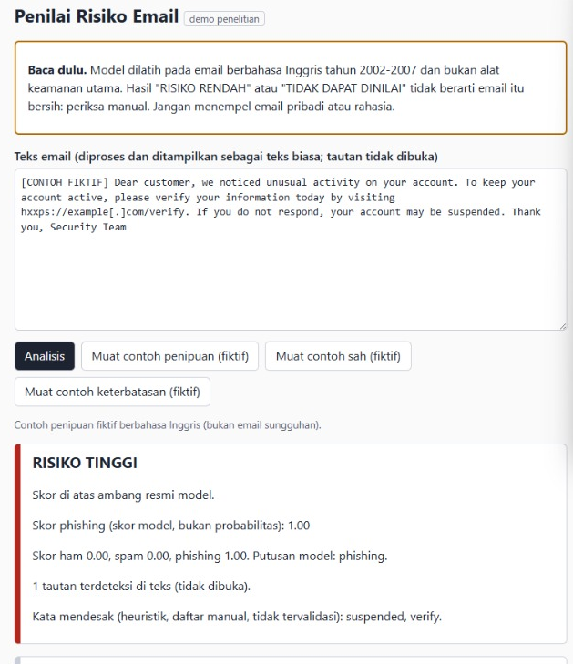
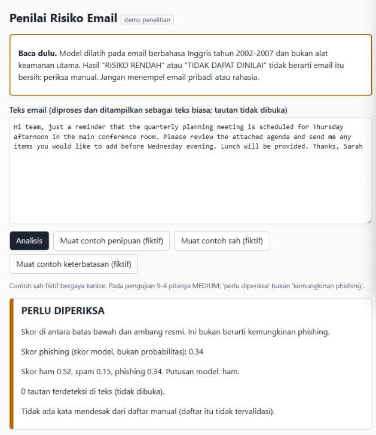
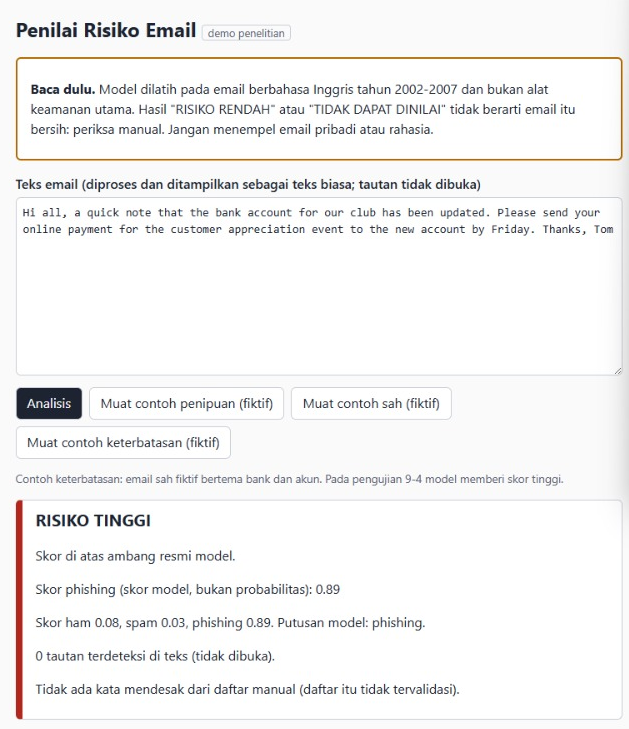

# Phishing Detection ML: studi kasus evaluasi detektor phishing


Proyek ini bertanya satu hal: seberapa jujur kita bisa mengukur detektor phishing berbasis teks (TF-IDF + regresi logistik), dan apa yang terjadi ketika angka yang tinggi diperiksa satu per satu. Hasil utamanya bukan modelnya, melainkan temuan tentang cara mengevaluasinya.

**English summary.** This repository is a case study in evaluating a text-based phishing email classifier (TF-IDF + logistic regression), not a ready-made detector. The headline scores on internal data are high, but the class is confounded with the data source, so the findings about how to evaluate matter more than the model [Kesimpulan 6].

> **Status:** model, tes, dan aplikasi demo lokal sudah selesai; model dirilis sebagai satu berkas zip di tab Releases (hash di bagian "Cara menjalankan"). Panduan merekonstruksi dataset dari sumber asli ada di `docs/reproduce.md` (belum diuji end-to-end dari nol oleh orang lain). Lencana CI di atas menunjukkan bahwa tes dengan model sintetis lulus dan model asli dari Release v1.0.0 mereproduksi 12 contoh fiktif di Linux, bukan kualitas model [Hasil 13a] [Hasil Tahap 15 S5].
> Proyek ini untuk tujuan **edukasi dan pengujian defensif**. Ini BUKAN filter email dan BUKAN jaminan keamanan. Jangan jadikan satu-satunya dasar menilai sebuah email.

**Cara membaca penunjuk.** Setiap klaim berangka diikuti penunjuk seperti [Hasil 8-5] ke bagian bernama itu di [docs/experiment_design.md](docs/experiment_design.md) (judul lengkapnya "Hasil Tahap 8-5 ..."; [Kesimpulan 6] berarti "Kesimpulan Tahap 6"). Tiga label dipakai: **terkunci** (aturan dan prediksi ditulis dan dikomit sebelum hasil), **eksploratif** (disusun setelah melihat data, tidak membuktikan apa pun), dan **hipotesis** (belum diuji).

## Ringkasan

- **Yang dibangun:** pengklasifikasi tiga kelas (ham, spam, phishing) dari teks isi email: rata-rata 5 model TF-IDF + regresi logistik (C=1), dengan ambang phishing tetap 0,5039704393178396 dari target recall 0,93 pada data latih [Kesimpulan 7; Hasil 8-5]. Ada aplikasi demo lokal (Flask, 127.0.0.1) yang menampilkan skor, pita risiko, dan status "tidak dapat dinilai".
- **Angka yang menggoda:** pada test internal (n=1860, dibuka sekali) recall phishing 0,9467 dan precision 0,9816 [Hasil 8-5].
- **Mengapa angka itu tidak cukup:** semua phishing berasal dari satu sumber dan semua ham/spam dari sumber lain, jadi kelas = sumber. Model yang hanya melihat bentuk email (tanpa teks) sudah mencapai PR-AUC phishing 0,995 [Hasil Uji Artefak Awal]. Skor tinggi di sini tidak membuktikan kemampuan membedakan phishing di luar data ini.
- **Yang saya lakukan:** menguji jalan pintas, kebocoran, data eksternal, dan perilaku aplikasi, dengan aturan dan prediksi dikunci sebelum hasil, dan mencatat prediksi yang meleset.

## Peta repo

- `src/app.py`, `src/penilai.py`, `src/static/`: aplikasi demo lokal (Flask, 127.0.0.1) dan logika penilaian; model dimuat hanya lewat `src/frozen_model.py`, yang memeriksa SHA256 sebelum memuat.
- `src/extract_*.py`, `src/build_dataset.py`, `src/make_clean_dataset.py`, `src/make_splits.py`: membangun dataset dan pembagian data dari sumber asli (data tidak ada di repo).
- `src/eda_*.py`, `src/cv_*.py`, `src/ablate_*.py`, `src/lofo_phishing.py`, `src/lobo_brand.py`, `src/eval_*.py`, `src/explain_global.py`: skrip analisis yang dibekukan; hasilnya dicatat di `docs/experiment_design.md`.
- `src/freeze_model.py` dan `docs/model_manifest.json`: membekukan 5 model dan mencatat hash serta versi pustaka.
- `docs/experiment_design.md`: catatan eksperimen berurutan (aturan, prediksi, hasil, koreksi); semua penunjuk di README mengarah ke sini.
- `docs/reproduce.md`, `docs/split_list.tsv`, dan `src/export_split_list.py`: langkah merekonstruksi dataset dan daftar pembagian data (hash, label, grup, bagian; tanpa isi email).
- `docs/MODEL_CARD.md` dan `docs/security_checklist.md`: kartu model dan daftar centang keamanan aplikasi.
- `docs/app_rules.json` dan `samples/contoh_fiktif.json`: aturan pita dan gerbang aplikasi, serta 12 contoh email fiktif.
- `tests/`: tes pytest dengan model sintetis (tanpa data dan tanpa model asli).
- `requirements*.txt` dan `.github/workflows/tests.yml`: dependensi terkunci (runtime, dev, analisis) dan CI.
- `SOURCES.md`, `NOTICE`, `LICENSE`: asal data, atribusi, dan lisensi kode (MIT).
- `data/` dan `models/` diabaikan Git: data mentah tidak ada di repo, dan model ada di tab Releases.

## Apa yang saya temukan

1. **Kelas = sumber (jalan pintas).** Semua phishing berasal dari satu sumber (Nazario) dan semua pembanding dari sumber lain; header status ada di 100% phishing dan 0% ham/spam [Kesimpulan 6]. Model bentuk-saja mencapai PR-AUC phishing 0,995, dan membuang satu kelompok fitur tidak cukup untuk menghilangkannya [Hasil Uji Artefak Awal]. Akibatnya data internal tidak bisa membuktikan nilai tambah model teks [Kesimpulan 6].
2. **Near-duplicate bukan penyebab utama.** Memperketat grup sampai kemiripan 0,7 hanya menurunkan PR-AUC dari 0,9941 ke 0,9931 [Hasil 8-1].
3. **Kebocoran tingkat merek atau kit (hipotesis).** Tiga domain bank (209 email di satu file, dalam 207 grup) punya recall 0,943 pada validasi acak tetapi 0,129 saat file itu ditahan [Hasil 6-6]. Ditahan sebagai merek bersamaan, recall 0,245 (eksploratif) [Hasil 7-4]. Pada validasi leave-one-brand-out 16 merek, recall turun dari 0,972 ke 0,939, terkonsentrasi di tiga bank itu [Kesimpulan 7]. Penyebab pastinya (keluarga merek atau kit) belum diuji.
4. **Fitur link menolong merek yang ditahan, tetapi menambah salah tangkap.** Dengan fitur link, recall merek ditahan naik (0,939 ke 0,973; 53.com 0,443 ke 0,987), tetapi PR-AUC turun (0,9941 ke 0,9904) dan ham yang salah ditandai phishing naik dari 5 ke 51. Kontrol dengan link diacak hampir sama dengan teks saja, jadi efeknya nyata. Fitur link ditolak menurut aturan terkunci [Hasil 8-2]. Dugaan sebabnya (jalan pintas "email HTML berlink") hipotesis dan tidak diuji.
5. **Benchmark jenuh.** Pada email HTML tanpa header milis, AUC phishing vs spam model bentuk 0,993 dan model teks 0,996; tidak ada model yang mengalahkan bentuk menurut aturan terkunci [Kesimpulan 6].
6. **Ambang tidak setara antar model dan bergeser pada data asing.** Pada ambang yang sama, recall berbeda antar model (0,9297 teks, 0,9389 teks + link, 0,9271 link diacak; eksploratif) [Hasil 8-2]. Ambang recall 0,93 turun dari 0,5040 ke 0,4889 saat grup diperketat sampai kemiripan 0,7 (eksploratif) [Hasil 8-1].
7. **Uji eksternal: "sebagian".** Pada phishing modern 2015-2025 (3075 email unik, pengumpul yang sama) recall 0,7919 (Wilson 95% 0,777-0,806); tren eksploratif per tahun: sekitar 0,85 (2015-2018) ke sekitar 0,75 (2019-2025) [Hasil 8-4-2]. Pada MeAJOR, 4,28% dari 60648 email berlabel 0 ditandai phishing (batas terkunci 1,0% gagal); penyebabnya tidak terpisahkan antara kerapuhan model dan artefak format anonim [Hasil 8-3-2].
8. **Teks kosong dinilai phishing, jadi aplikasi butuh gerbang.** Teks tanpa kata dikenal mendapat skor 0,5158, di atas ambang 0,5040 [Kesimpulan 8]. Gerbang awal (persentil ke-1) tumpul: `N_MIN`=1 dan `C_MIN`=0,00 [Hasil 9-3]. Gerbang v2 (16 kata dikenal, cakupan 0,77) dirancang setelah melihat hasil itu (eksploratif); ia meloloskan 92,89% data latih dan menahan 289 phishing latih [Hasil 9-3c]. Yang tertahan berstatus "tidak dapat dinilai", BUKAN aman. Gerbang mengukur kosakata Inggris yang dikenal model, bukan bahasa [Hasil 9-3c].
9. **Bobot kata bukan sebab-akibat.** Menghapus 40 kata teratas menurunkan PR-AUC 0,9941 ke 0,9914 (penurunan acak terbesar 0,0001) dan recall pada ambang tetap 0,9301 ke 0,8834. Ranking hampir tidak berubah, jadi model memakai isyarat berlebih; ini tidak membantah jalan pintas [Hasil 9-2]. Kata penjauh dari phishing didominasi perlengkapan milis dan nama sumber (hipotesis penanda sumber) [Hasil 9-1].
10. **Contoh fiktif adalah demonstrasi, bukan evaluasi.** Dari 12 contoh fiktif, ketiga contoh Indonesia ditahan gerbang v2 [Hasil 9-4]. Email sah bertema bank (E11) tetap berpita HIGH dengan skor 0,89 (hipotesis: kepekaan pada kosakata akun dan bank) [Hasil 10]. Skor bukan probabilitas: pada bin 0,4-0,5 (n=21) rata-rata skor 0,452 tetapi phishing sebenarnya 0,857 [Hasil 8-5].
11. **Mesin bersih menemukan yang tidak terlihat di laptop.** Run pertama CI gagal karena pytest ikut mengumpulkan skrip analisis (namanya berakhiran `_test.py`) yang menjalankan analisis saat diimpor; tes hijau di laptop tidak mengungkapnya [Hasil 13a].

## Angka utama berdampingan

| Ukuran                      | Nilai                                                                 | Berlaku untuk                                                    | Penunjuk     |
| --------------------------- | --------------------------------------------------------------------- | ---------------------------------------------------------------- | ------------ |
| Test internal               | recall phishing 0,9467 (Wilson 0,927-0,961), precision 0,9816         | n=1860, sumber sama dengan data latih, dibuka sekali; optimistis | Hasil 8-5    |
| Test, per grup              | recall 0,9120                                                         | 409 grup                                                         | Hasil 8-5    |
| Merek ditahan (LOBO16)      | recall 0,939                                                          | data latih, 16 merek; eksploratif                                | Kesimpulan 7 |
| Tiga bank ditahan bersamaan | recall 0,245                                                          | data latih, 212 email; eksploratif                               | Hasil 7-4    |
| Phishing modern 2015-2025   | recall 0,7919 (Wilson 0,777-0,806)                                    | 3075 email unik, satu pengumpul; hanya recall                    | Hasil 8-4-2  |
| MeAJOR label 0              | 4,28% ditandai phishing                                               | 60648 email, format anonim; penyebab tak terpisahkan             | Hasil 8-3-2  |
| Precision indikatif         | 0,486 pada prevalensi 1%; 0,831 pada 5%                               | dihitung dari tingkat salah tangkap test (0,0101)                | Hasil 8-5    |
| Pita risiko (indikatif)     | HIGH n=2549 (98,6% phishing); MEDIUM n=515 (31,5%); LOW n=4374 (0,6%) | validasi silang data latih, prevalensi 36,3%                     | Hasil 9-3    |

Baca baris pertama sebagai batas atas, dan baris-baris sesudahnya sebagai seberapa cepat angka itu jatuh ketika merek, tahun, atau sumber berubah.

## Contoh hasil

Tiga dari 12 contoh fiktif ([samples/contoh_fiktif.json](samples/contoh_fiktif.json)), seperti tampil di aplikasi demo lokal. Ini demonstrasi perilaku aplikasi, bukan evaluasi model [Hasil 9-4]. Penggunaan dan batas model ada di [kartu model](docs/MODEL_CARD.md).







Seluruh 12 contoh. "Kata dikenal / token" membandingkan kata yang ada di kosakata model dengan jumlah token; "Putusan model" adalah kelas pilihan model bila tidak ada gerbang [Hasil 9-4].

| Contoh  | Kelompok                                        | Kata dikenal / token | Putusan model | Skor ham / spam / phishing | Status di aplikasi            |
| ------- | ----------------------------------------------- | -------------------- | ------------- | -------------------------- | ----------------------------- |
| E01-E03 | teks kosong, spasi saja, angka saja             | 0 / 0                | phishing      | 0,31 / 0,17 / 0,52         | TIDAK DAPAT DINILAI           |
| E04     | Indonesia, sah                                  | 4 / 20               | ham           | 0,44 / 0,14 / 0,42         | TIDAK DAPAT DINILAI           |
| E05     | Indonesia, penipuan fiktif                      | 4 / 23               | ham           | 0,51 / 0,13 / 0,36         | TIDAK DAPAT DINILAI           |
| E06     | Indonesia campur Inggris                        | 5 / 20               | ham           | 0,29 / 0,26 / 0,46         | TIDAK DAPAT DINILAI           |
| E07     | Inggris, sangat pendek                          | 4 / 4                | spam          | 0,24 / 0,26 / 0,50         | TIDAK DAPAT DINILAI           |
| E08     | Inggris, sah (bergaya kantor)                   | 36 / 37              | ham           | 0,52 / 0,15 / 0,34         | PERLU DIPERIKSA (pita MEDIUM) |
| E09     | Inggris, penipuan fiktif                        | 31 / 34              | phishing      | 0,00 / 0,00 / 1,00         | RISIKO TINGGI                 |
| E10     | Inggris, spam fiktif                            | 30 / 32              | spam          | 0,02 / 0,96 / 0,02         | RISIKO RENDAH (pita LOW)      |
| E11     | Inggris, sah bertema bank (contoh keterbatasan) | 29 / 29              | phishing      | 0,08 / 0,03 / 0,89         | RISIKO TINGGI                 |
| E12     | Inggris, phishing fiktif pendek                 | 9 / 13               | ham           | 0,35 / 0,28 / 0,37         | TIDAK DAPAT DINILAI           |

Delapan dari 12 contoh berstatus TIDAK DAPAT DINILAI, dan itu BUKAN aman. Tanpa gerbang, dua contoh phishing fiktif (E05 dan E12) diputus ham, dan teks kosong (E01-E03) diputus phishing [Hasil 9-4; Kesimpulan 8]. E11 menunjukkan arah sebaliknya: email sah diberi skor tinggi (hipotesis: kepekaan pada kosakata akun dan bank) [Hasil 10]. Daftar kata di aplikasi (tidak tampak di gambar) adalah bobot statistik, bukan sebab-akibat.

## Keterbatasan

Klaim di proyek ini hanya berlaku pada data yang diuji, dan banyak butir di bawah adalah hipotesis yang belum diuji.

**Data dan cakupan klaim**

- Klaim hanya untuk phishing klasik 2002-2007 dari sumber ini, ditambah "sebagian" untuk phishing modern dari pengumpul yang sama [Kesimpulan 8].
- Phishing berasal dari satu sumber (korpus Nazario); ham dan spam dari satu sumber lain [Kesimpulan 6].
- Data dominan bahasa Inggris; bahasa Indonesia hanya diuji pada 3 contoh fiktif, dan bahasa lain tidak diuji [Hasil 9-4].
- Tidak ada ham modern, dan ham HTML hanya 142 di data latih [Hasil 5c-2; Kesimpulan 8].
- 54 dari 1860 email test (2,9%) punya kembaran isi di data latih [Hasil 8-5].

**Model**

- Skor bukan probabilitas terkalibrasi (bin 0,4-0,5: 0,452 vs 0,857, n=21) [Hasil 8-5].
- Ambang tidak setara antar model dan memberi recall lebih rendah pada data asing (0,79 vs 0,93 pada data latih) [Hasil 8-2; Hasil 8-4-2].
- Precision turun pada prevalensi realistis: 0,486 pada 1% [Hasil 8-5].
- Titik lemah (hipotesis, n kecil, dari test yang sudah dibuka): phishing tanpa HTML terdeteksi 18 dari 27 (0,667), yang berlampiran 0,750 [Hasil 8-6].
- Pita risiko diturunkan dari validasi silang model tunggal lalu dipakai pada rata-rata 5 model, jadi indikatif. MEDIUM lebar (31,5% phishing) berarti "perlu diperiksa", bukan "kemungkinan phishing" [Hasil 9-3; Hasil 9-4].
- Gerbang masukan dirancang setelah melihat hasil, hanya mengukur kosakata Inggris yang dikenal, dan menahan 289 phishing latih yang skornya belum diperiksa [Hasil 9-3c].
- Kosakata model memuat nama orang (mis. annie, paul), dan daftar kata pendorong adalah bobot statistik, bukan sebab-akibat [Hasil 9-1].
- Skor sama pada ambang (ties) belum diperiksa [Hasil 7-4].

**Aplikasi dan rekayasa**

- Aplikasi hanya lokal: server pengembangan Flask, tanpa TLS, autentikasi, atau pembatasan laju; belum untuk diterbitkan publik [docs/security_checklist.md](docs/security_checklist.md).
- Tes UI bersifat statis (bukan tes browser), dan pemeriksaan manual (Console di bawah CSP, warna kartu) hanya dilakukan sekali, di satu peramban (bawaan VS Code) tanpa mode gelap [docs/security_checklist.md](docs/security_checklist.md).
- Parser tidak diperbaiki di rilis ini: header Content-Type rusak membuat isi kosong, host Unicode tidak ditandai punycode, tautan tanpa skema tidak dihitung [Hasil 12]. Daftar kata mendesak di UI dibuat manual dan tidak divalidasi [Hasil 10].
- Hasil terverifikasi hanya di Windows (laptop penulis) dan runner Linux GitHub. Tag action memakai versi mayor (`@v7`) dan label `ubuntu-latest` dapat berubah [Hasil 13a].
- Berkas model memakai joblib (format pickle): hash SHA256 membuktikan integritas, BUKAN keamanan. Muat hanya model dari rilis yang hash-nya dicocokkan.

## Data dan atribusi

Data mentah tidak disertakan di repo ini. Tiga sumber dipakai: SpamAssassin Public Corpus (ham dan spam; tanpa lisensi formal, hak cipta pesan tetap milik pengirim, diverifikasi dari readme sumber pada 6 Nov 2026), Nazario Phishing Corpus (phishing; CC BY 4.0, diverifikasi dari README.txt dan LICENSE.txt sumber pada 6 Nov 2026), dan MeAJOR (hanya uji eksternal; CC BY 4.0, diverifikasi di halaman Zenodo pada 4 Nov 2026). Rincian ada di [NOTICE](NOTICE) dan [SOURCES.md](SOURCES.md). Email phishing adalah bahan berbahaya: berkas mbox hanya diekstraksi di container sekali pakai dan hanya CSV teks bersih yang keluar.

## Cara menjalankan

Terverifikasi dengan Python 3.14.3 (Windows, Git Bash) dan Python 3.14 di GitHub Actions. Versi paket dikunci persis di `requirements*.txt`, dan model terikat versi itu.

**Menjalankan tes** (tanpa data dan tanpa model; tes memakai model sintetis [Hasil 13a]):

```bash
python -m venv .venv
source .venv/Scripts/activate
python -m pip install --only-binary=:all: -r requirements-dev.txt
python -m pytest -q
```

Hasil yang diharapkan: 99 tes lolos [Hasil Tahap 15 S3].

**Menjalankan aplikasi demo** (butuh lima model dari rilis):

1. Pasang paket runtime: `python -m pip install --only-binary=:all: -r requirements.txt`.
2. Unduh `phishing-models-v1.zip` dari tab Releases repo ini (rilis v1.0.0).
3. Periksa SHA256 zip sebelum diekstrak. Nilai yang benar: `24792390c0f2d86375014ac953ea5b1f98702373982a5ee09bb96d19adb58100` (Git Bash atau Linux: `sha256sum phishing-models-v1.zip`; PowerShell: `Get-FileHash -Algorithm SHA256 phishing-models-v1.zip`).
4. Dari akar repo, ekstrak zip (membuat folder `models/`): `python -m zipfile -e phishing-models-v1.zip .`
5. Periksa model: `python -m src.cek_penilai_fiktif` harus mencetak `KONTROL OK: 12 dari 12`. Lalu jalankan `python -m src.app` dan buka alamat 127.0.0.1 port 5000 di browser (hanya lokal; Ctrl+C untuk berhenti).

Hash zip dan hash tiap model membuktikan INTEGRITAS (berkas sama dengan yang dirilis), BUKAN keamanan: format joblib adalah pickle, dan aplikasi memeriksa SHA256 setiap model terhadap [docs/model_manifest.json](docs/model_manifest.json) sebelum memuatnya. Pemeriksaan 12 contoh dijalankan di Windows (laptop penulis) dan di runner Linux GitHub lewat CI [Hasil Tahap 15 S5]. Langkah merekonstruksi dataset dari sumber asli ada di [docs/reproduce.md](docs/reproduce.md) dan belum diuji end-to-end dari nol oleh orang lain.

## Lisensi

MIT. Lihat berkas [LICENSE](LICENSE). Data memiliki syarat sendiri (lihat [NOTICE](NOTICE)).
